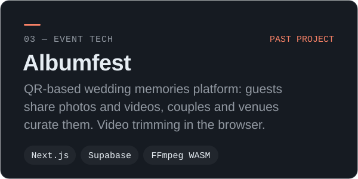

<picture><source media="(prefers-color-scheme: dark)" srcset="assets/header-dark.svg"/><source media="(prefers-color-scheme: light)" srcset="assets/header-light.svg"/></picture>

 

I've been building software since 2018. Today I work AI-first: I shape the product, design the data model and architecture, write precise specs, and orchestrate AI coding agents to implement them, then review, test and harden every change before it ships. The result is production systems shipped at the pace of a small team, without giving up on clean data models, database-level permissions and interfaces people don't need a manual for.

### Selected work

<a href="https://github.com/Er4yB0ran/parca-hizmetleri-saas"><picture><source media="(prefers-color-scheme: dark)" srcset="assets/card-parca-hizmetleri-dark.svg"/><source media="(prefers-color-scheme: light)" srcset="assets/card-parca-hizmetleri-light.svg"/></picture></a>
<picture><source media="(prefers-color-scheme: dark)" srcset="assets/card-ela-akademi-dark.svg"/><source media="(prefers-color-scheme: light)" srcset="assets/card-ela-akademi-light.svg"/></picture>

<picture><source media="(prefers-color-scheme: dark)" srcset="assets/card-albumfest-dark.svg"/><source media="(prefers-color-scheme: light)" srcset="assets/card-albumfest-light.svg"/></picture>
<a href="https://github.com/Er4yB0ran/ProjectX"><picture><source media="(prefers-color-scheme: dark)" srcset="assets/card-projectx-dark.svg"/><source media="(prefers-color-scheme: light)" srcset="assets/card-projectx-light.svg"/></picture></a>

**Also:** Fox, a Turkish-speaking AI assistant with hybrid LLM routing and browser control · a guidance tracking system for school counselors · an animated studio website built with GSAP and Canvas.

### Experience

**Independent** — SaaS & e-commerce 
Designing and shipping multi-tenant platforms end to end, from database and payments to UI.

**Mercedes-Benz** — IT Intern 
Corporate IT infrastructure, system operations and security processes.

**Voltaria Robotics (FRC)** — Software Co-Captain 
Led the software team and owned technical decisions between mechanical design and control code.

### Toolbox

**Languages** TypeScript, JavaScript, Java, SQL, PHP 
**Frontend** React, Next.js, Tailwind CSS, GSAP 
**Backend** Node.js, Supabase, PostgreSQL (RLS, RPC), Server Actions 
**Infrastructure** Vercel, Cloudflare R2, GitHub Actions 
**AI workflow** Claude Code, multi-agent orchestration, spec-driven development, prompt design 
**AI in products** Claude API, Vercel AI SDK, Groq, Ollama, Playwright automation

### Contact

[erayboranagirdici@gmail.com](mailto:erayboranagirdici@gmail.com) · [LinkedIn](https://www.linkedin.com/in/eray-a%C4%9F%C4%B1rd%C4%B1c%C4%B1-a69540360/)
