  

 

Full-Stack Developer with a security-first mindset. Building software since 2018 — from early algorithmic problem-solving to architecting modern, data-intensive web applications. Long-term vision: a technology startup at the intersection of scalable software and secure infrastructure.

##  Experience

**Mercedes-Benz — IT Intern**
Hands-on enterprise experience in corporate IT infrastructure, system operations, and security processes.

**Voltaria Robotics (FRC) — Software Co-Captain**
Led the software team, drove technical decision-making, and bridged the gap between mechanical engineering and algorithmic logic.

**Independent Ventures — SaaS & E-Commerce**
Architected nationwide depot management systems and high-traffic B2C/B2B supply chains (**Parça Hizmetleri**) alongside modern event-tech solutions (**Albumfest**).

##  Featured Projects

<table>
<tr>
<td width="50%" valign="top">

**Parça Hizmetleri** — Auto Parts SaaS
Mobile-first B2B/B2C platform for the auto spare parts industry: multi-depot inventory, dynamic pricing and a 200K+ part catalog indexed through programmatic SEO.

Next.js · Supabase · TypeScript · Tailwind CSS

[Live](https://otoyedekb2b.vercel.app) · [Case study](https://github.com/Er4yB0ran/parca-hizmetleri-saas)

</td>
<td width="50%" valign="top">

**Ela Akademi Panel** — Academy Management
Website and admin panel for a language academy: finance and collections, teachers, students, front desk, classes and attendance — run from a single system.

Next.js · Supabase · TypeScript · Playwright

Private repository

</td>
</tr>
<tr>
<td width="50%" valign="top">

**ODI QR** — Digital Wedding Memories
Guests scan a QR code to upload photos and videos; couples and venues curate everything from dedicated dashboards. In-browser video trimming with FFmpeg WASM.

Next.js · Supabase · Cloudflare R2

[Live](https://odiqr.vercel.app) · Private repository

</td>
<td width="50%" valign="top">

**ProjectX** — AI Weekly Planner
Builds a weekly skeleton around your energy cycle, turns it into daily tasks, reschedules what slips and learns from your behavior.

Next.js · Supabase · Claude · Vercel AI SDK

[Live](https://project-x-pi-five.vercel.app) · [Repository](https://github.com/Er4yB0ran/ProjectX)

</td>
</tr>
<tr>
<td width="50%" valign="top">

**Fox** — Personal AI Assistant
Turkish-speaking assistant with hybrid LLM routing (Cerebras, Groq, Ollama, Claude), browser control via Playwright and an AES-256 encrypted credential vault.

Node.js · Playwright · LLM tool calling

Private repository

</td>
<td width="50%" valign="top">

**Guidance Tracker** — School Counseling
Student guidance tracking for school counselors: student records, search and filtering, meeting logs and reporting.

PHP · MySQL · JavaScript

Private repository

</td>
</tr>
</table>

##  Tech Stack

  
  
  
  
  
  
  
  
  
  
  

 

**Core focus:** SaaS Architecture · Secure-by-Design Systems · Analytical Problem Solving · Large-Scale Data Management

##  Contact

  

  
  
  

##  Analytics

  

  <picture>
    <source media="(prefers-color-scheme: dark)" srcset="https://raw.githubusercontent.com/Er4yB0ran/Er4yB0ran/output/github-contribution-grid-snake-dark.svg"/>
    
  </picture>

