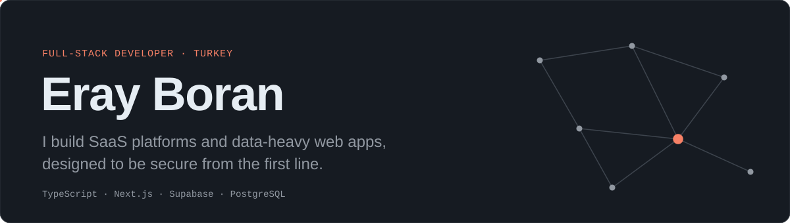
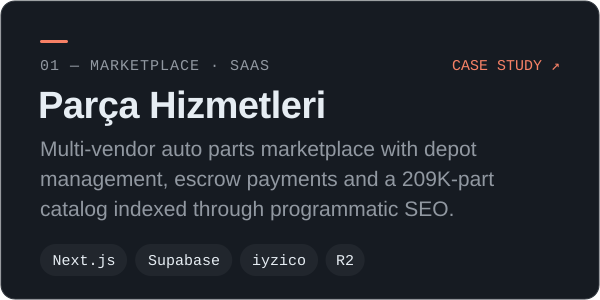
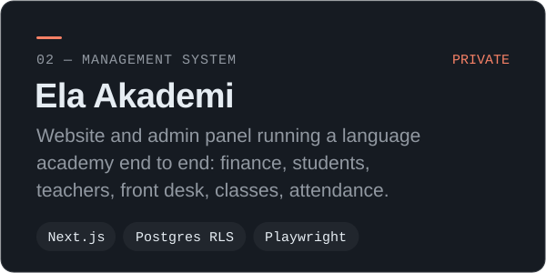
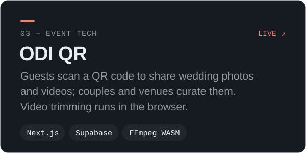
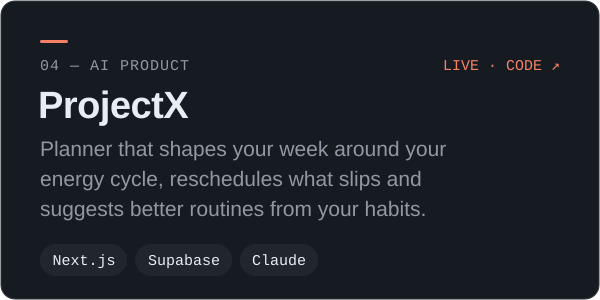

<picture><source media="(prefers-color-scheme: dark)" srcset="assets/header-dark.svg"/><source media="(prefers-color-scheme: light)" srcset="assets/header-light.svg"/></picture>

 

I've been writing software since 2018, starting with algorithmic problem solving and moving on to production systems that real businesses run on. I care about clean data models, permissions done right at the database level, and interfaces people don't need a manual for. Long term, I'm building toward a technology company at the intersection of scalable software and secure infrastructure.

### Selected work

<a href="https://github.com/Er4yB0ran/parca-hizmetleri-saas"><picture><source media="(prefers-color-scheme: dark)" srcset="assets/card-parca-hizmetleri-dark.svg"/><source media="(prefers-color-scheme: light)" srcset="assets/card-parca-hizmetleri-light.svg"/></picture></a>
<picture><source media="(prefers-color-scheme: dark)" srcset="assets/card-ela-akademi-dark.svg"/><source media="(prefers-color-scheme: light)" srcset="assets/card-ela-akademi-light.svg"/></picture>

<a href="https://odiqr.vercel.app"><picture><source media="(prefers-color-scheme: dark)" srcset="assets/card-odi-qr-dark.svg"/><source media="(prefers-color-scheme: light)" srcset="assets/card-odi-qr-light.svg"/></picture></a>
<a href="https://github.com/Er4yB0ran/ProjectX"><picture><source media="(prefers-color-scheme: dark)" srcset="assets/card-projectx-dark.svg"/><source media="(prefers-color-scheme: light)" srcset="assets/card-projectx-light.svg"/></picture></a>

**Also:** Fox, a Turkish-speaking AI assistant with hybrid LLM routing and browser control · a guidance tracking system for school counselors · an animated studio website built with GSAP and Canvas.

### Experience

**Independent** — SaaS & e-commerce 
Designing and shipping multi-tenant platforms end to end, from database and payments to UI.

**Mercedes-Benz** — IT Intern 
Corporate IT infrastructure, system operations and security processes.

**Voltaria Robotics (FRC)** — Software Co-Captain 
Led the software team and owned technical decisions between mechanical design and control code.

### Toolbox

**Languages** TypeScript, JavaScript, Java, SQL, PHP 
**Frontend** React, Next.js, Tailwind CSS, GSAP 
**Backend** Node.js, Supabase, PostgreSQL (RLS, RPC), Server Actions 
**Infrastructure** Vercel, Cloudflare R2, GitHub Actions 
**AI** Claude, Vercel AI SDK, Groq, Ollama, Playwright automation

### Contact

[erayboranagirdici@gmail.com](mailto:erayboranagirdici@gmail.com) · [LinkedIn](https://www.linkedin.com/in/eray-a%C4%9F%C4%B1rd%C4%B1c%C4%B1-a69540360/)
